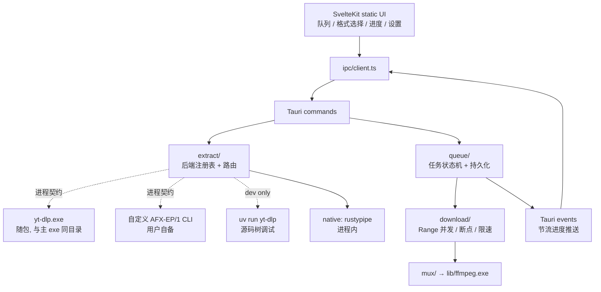

# AutoFox 概要设计

版本：v1（2026-09-25）
前置阅读：[01-可行性评估](01-可行性评估.md)

本文确定分层、技术基线与版本、目录结构、Tauri command/event 面和首版闭环。后端接入的字段级契约见 [03-后端契约](03-后端契约.md)。

---

## 1. 设计原则

### 1.1 后端是插件，不是编译期选择

解析后端通过进程契约接入，**用户在设置里选，不需要重新编译 AutoFox**。AutoFox 不假设任何特定后端存在，也不把某个后端的字段结构泄漏到下载层。

### 1.2 下载层不知道后端是谁

`MediaManifest` 是所有后端的归一化产物。下载引擎、队列、UI 只认它。这条约束保证换后端不触碰下载代码。

### 1.3 Tauri 只做边界

沿用 AutoAnt 的分层，command 只负责 DTO 解码、调用 service、DTO 编码：

```text
Svelte route/component
        ↓
$lib/ipc/client.ts（唯一 invoke/listen 入口）
        ↓
Tauri command（DTO 边界、权限、并发卫兵）
        ↓
extract / download / queue / mux（领域服务）
        ↓
system（文件、进程、网络、平台）
```

### 1.4 首版先完成一个闭环

粘 URL → 解析出格式表 → 选格式 → 下载（可暂停/续传）→ 合流 → 落盘可播放文件。其他功能不得挤占这条链路。

---

## 2. 系统上下文



外部依赖：至少一个可用解析后端、ffmpeg（合流所需，随包置于 `lib/`）、Windows WebView2。**运行期无 Python、无 PATH 依赖、无云端服务、无常驻后台进程**——`yt-dlp.exe` 为 PyInstaller 冻结产物，解释器在 exe 内部。布局见 [01 §5](01-可行性评估.md)。

---

## 3. 技术基线

版本均为 2026-09-25 实测最新稳定版。**精确锁定**，理由同 AutoAnt：桌面应用的可复现构建优先于自动升级。

### 3.1 工具链

| 项 | 版本 | 固定方式 |
|---|---|---|
| Node | 24.21.0（LTS Krypton） | `.nvmrc` + `scripts/check-node.mjs` |
| pnpm | 12.6.0 | `packageManager` + `engines` + preinstall 门禁 |
| Rust | 1.98.1 | `rust-toolchain.toml` |
| Cargo edition | 2024 | `[workspace.package]` |

26.10.0 是 Current 非 LTS，桌面工具链不取。

### 3.2 前端

| 包 | 版本 |
|---|---|
| svelte | 5.57.1 |
| @sveltejs/kit | 2.70.3 |
| @sveltejs/adapter-static | 3.0.10 |
| vite | 8.3.1 |
| typescript | 7.0.2 |
| tailwindcss / @tailwindcss/vite | 4.3.3 |
| bits-ui | 2.19.3 |
| shadcn-svelte | 1.7.0 |
| svelte-check | 4.7.6 |
| eslint | 10.11.0 |
| @tauri-apps/api | 2.11.1 |
| @tauri-apps/cli | 2.11.5 |

### 3.3 Rust

| crate | 版本 | 用途 |
|---|---|---|
| tauri | 2.11.6 | 壳 |
| tauri-build | 2.6.3 | 构建 |
| tauri-plugin-dialog | 2.7.3 | 目录/文件选择 |
| tauri-plugin-opener | 2.5.5 | 打开产物目录 |
| tokio | 1.53.1 | 运行时；**需 `process` feature**（子进程后端） |
| reqwest | 0.13.5 | 下载；`rustls-no-provider` + `stream` |
| rustls | 0.23.45 | TLS，**ring provider** |
| serde_json | 1.0.151 | `preserve_order` |
| thiserror | 2.0.21 | 错误 |
| uuid | 1.26.1 | 任务 ID |
| tempfile | 3.27.0 | `.part` 落盘 |
| sha2 | 0.11.0 | 校验（⚠️ 相对 AutoAnt 0.10 为破坏性升级，`digest` 0.11 API 变更） |
| base64 | 0.23.1 | ⚠️ 相对 AutoAnt 0.22 为破坏性升级 |
| futures-util | 0.3.34 | 流组合 |
| windows | 0.62.2 | 平台调用 |

TLS 沿用 AutoAnt 的 **ring** 决策：`aws-lc-sys` 需 cmake + nasm，构建主机不具备。`rustls-platform-verifier` 保证使用 Windows 信任库。

### 3.4 构建约定（继承 AutoAnt）

- `.cargo/config.toml` 将 crates-io 源替换为 `.pnpm/crates/crates-io` 本地目录（离线 vendoring）。
- 构建、清理与 MSVC 环境由 [`@ouraihub/desktop-kit`](https://github.com/ouraihub/desktop-kit) 提供：`pnpm dev:app`、`pnpm build:app`（产物在 `dist/candidate-windows/`，并刷新 `dist/AutoFox/`）、`pnpm clean [--deep]`；cargo 命令走 `desktop-kit cargo`。便携 MSVC 默认 `D:\Applications\msvc-portable\msvc`，可用 `PORTABLE_MSVC_ROOT` 修改。
- workspace lints：`unwrap_used` / `expect_used` / `panic` / `todo` / `unimplemented` = warn，`undocumented_unsafe_blocks` = deny，`missing_docs` = warn。测试构建下 `#![cfg_attr(test, allow(...))]` 放开断言宏。
- release profile：`lto = true`、`codegen-units = 1`、`opt-level = "z"`、`strip = true`、`panic = "abort"`。

---

## 4. 目录结构

```text
AutoFox/
├─ docs/                      本目录
├─ src/                       SvelteKit 前端
│  ├─ lib/
│  │  ├─ ipc/client.ts        唯一 invoke/listen 入口
│  │  ├─ queue.svelte.ts      队列 store（runes）
│  │  ├─ backends.svelte.ts   后端健康状态 store
│  │  ├─ i18n/                locale.svelte.ts + messages/
│  │  └─ components/          ui/ + 业务组件
│  └─ routes/
├─ src-tauri/
│  ├─ src/
│  │  ├─ lib.rs               Builder / manage / invoke_handler
│  │  ├─ ipc.rs              ErrorCode / AfxError / Diagnostic
│  │  ├─ extract/             后端抽象（见 03）
│  │  │  ├─ mod.rs            Extractor trait / 注册表 / 路由
│  │  │  ├─ manifest.rs       MediaManifest 归一化模型
│  │  │  ├─ profile.rs        适配档解析（声明式）
│  │  │  ├─ process.rs        AFX-EP/1 进程后端
│  │  │  ├─ native.rs         rustypipe 进程内后端
│  │  │  └─ health.rs         探测与版本读取
│  │  ├─ download/
│  │  │  ├─ mod.rs            引擎入口
│  │  │  ├─ ranged.rs         Range 分段并发
│  │  │  ├─ hls.rs            RFC 8216
│  │  │  ├─ dash.rs           ISO/IEC 23009-1
│  │  │  ├─ throttle.rs       限速
│  │  │  └─ sink.rs           .part + 原子 rename
│  │  ├─ queue/
│  │  │  ├─ task.rs           状态机
│  │  │  ├─ store.rs          持久化与重启恢复
│  │  │  └─ cancel.rs         取消令牌
│  │  ├─ mux/                 ffmpeg 编排
│  │  ├─ settings.rs          settings.json
│  │  └─ system/              fs / process / paths
│  ├─ profiles/               内置适配档（yt-dlp.toml 等）
│  ├─ capabilities/ icons/ tauri.conf.json build.rs
├─ scripts/                   check-node / generate-notice / prepare-resources
├─ .cargo/config.toml  .nvmrc  rust-toolchain.toml
├─ Cargo.toml  pnpm-workspace.yaml  package.json
```

---

## 5. Command / Event 面

### 5.1 Command

| command | 作用 |
|---|---|
| `get_settings` / `save_settings` | 本机设置读写 |
| `list_backends` | 已注册后端 + 健康状态 + 能力 |
| `detect_backend` | 对指定路径探测版本与协议支持 |
| `add_backend` / `remove_backend` / `reorder_backends` | 用户管理后端列表 |
| `probe_url` | 解析单个 URL → `MediaManifest` |
| `enqueue` | 提交下载任务（manifest + 选中 format） |
| `pause_task` / `resume_task` / `cancel_task` / `remove_task` | 任务控制 |
| `list_tasks` | 队列快照（启动恢复用） |
| `choose_directory` | 输出目录选择（dialog 插件） |
| `reveal_output` | 打开产物所在目录（opener 插件） |
| `read_logs` / `clear_logs` | 读取进程内日志尾部（按设置的 `logLevel` 过滤）/ 清空缓冲 |

### 5.2 Event

| event | 载荷 | 节流 |
|---|---|---|
| `task://progress` | `{taskId, bytes, total, speed, eta, stage}` | ≥200ms 合并 |
| `task://state` | `{taskId, state, errorCode?}` | 不节流（状态跃迁） |
| `backend://health` | `{backendId, status, version?}` | 不节流 |

**进度必须节流**。未节流的 WebView IPC 在多任务并发时会淹没主线程。

### 5.3 任务状态机

```text
Queued → Probing → Selecting → Downloading ⇄ Paused
                                    ↓
                                 Muxing → Done
       任意态 → Cancelled | Failed
```

沿用 AutoAnt `runner/slot.rs` 的核心不变量：**终态由恰好一次后端跃迁确认**。`finish` 只对仍处 `Downloading`/`Muxing` 的任务成功，后续尝试一律拒绝——这使"完成"与"取消"竞态时按先到者收敛，不会发出两个终态事件。

---

## 6. 错误契约

沿用 AutoAnt `ipc.rs` 的信封：`code` + `messageKey` + `field` 全为编译期常量，**不含 URL、header、body、cookie、密钥**。后端 stderr 只进本地日志。

AutoFox 的 `ErrorCode`（相对 AutoAnt 增删后）：

```text
Validation            输入不合法（URL scheme、路径）
NoBackendAvailable    无任何就绪后端
BackendUnavailable    指定后端不可用（缺二进制/版本过低）
BackendProtocol       后端输出不符契约（JSON 不可解析、缺必需字段）
Unsupported           后端明确不支持该 URL
ExtractionFailed      后端解析失败（站点改版、私有视频）
AuthRequired          需要凭据/cookie
GeoRestricted         地域限制
FormatUnavailable     选中格式已失效
Network               网络失败
TimedOut              超时
Cancelled             用户取消
DiskFull / AtomicWrite  落盘失败
MuxFailed / MuxerMissing  合流失败 / 缺 ffmpeg
Busy                  超过并发上限
Internal              其他
```

**回退分界线**：仅 `Unsupported` 与 `ExtractionFailed` 触发后端回退。`Network` / `TimedOut` / `Cancelled` / `AuthRequired` / `GeoRestricted` **直接失败**——否则断网时会串行捶遍所有后端，等多次超时，并把真实原因掩盖成"全部失败"。详见 [03-后端契约](03-后端契约.md) §5。

---

## 7. 安全边界

| 面 | 措施 |
|---|---|
| 子进程参数 | 数组传参，绝不字符串拼接；`--` 终止选项解析 |
| URL | 进后端前校验 scheme ∈ {http, https}；拒绝 `file:`、`javascript:` 等 |
| 后端路径 | 用户指定路径需存在且可执行；记录探测到的版本；不静默 fallback 到 PATH |
| 输出路径 | 限制在用户显式授权目录内；文件名清洗（Windows 保留名、控制字符、路径穿越） |
| JSON 解析 | 全字段 `#[serde(default)]`，忽略未知字段，设大小上限防 OOM |
| 日志 | 进程内环形缓冲（上限 1000 行）；持久化到 `<exe>\data\logs\YYYY-MM-DD.log`（UTC 日期），并镜像到兼容路径 `autofox.log`；经 `read_logs` 供界面查看；写入前 URL 一律剥掉 query/fragment（签名、token 不落日志）；磁盘占用有界：日文件保留最近 14 天（启动时裁剪），镜像超过 512 KiB 时按行边界丢弃旧的一半；无遥测 |
| 网络 | 无出站上报；除用户请求的媒体与后端自身流量外不发请求 |

---

## 8. 首版闭环验收

粘贴一个真实 URL → 格式表出现（标明由哪个后端解析）→ 选一条 → 下载显示速度与 ETA → 中途暂停再续传字节数连续 → 合流产出可播放 mp4 → 重启应用后未完成任务可恢复。

以上每项的证据要求见 [04-实施计划](04-实施计划.md)。
