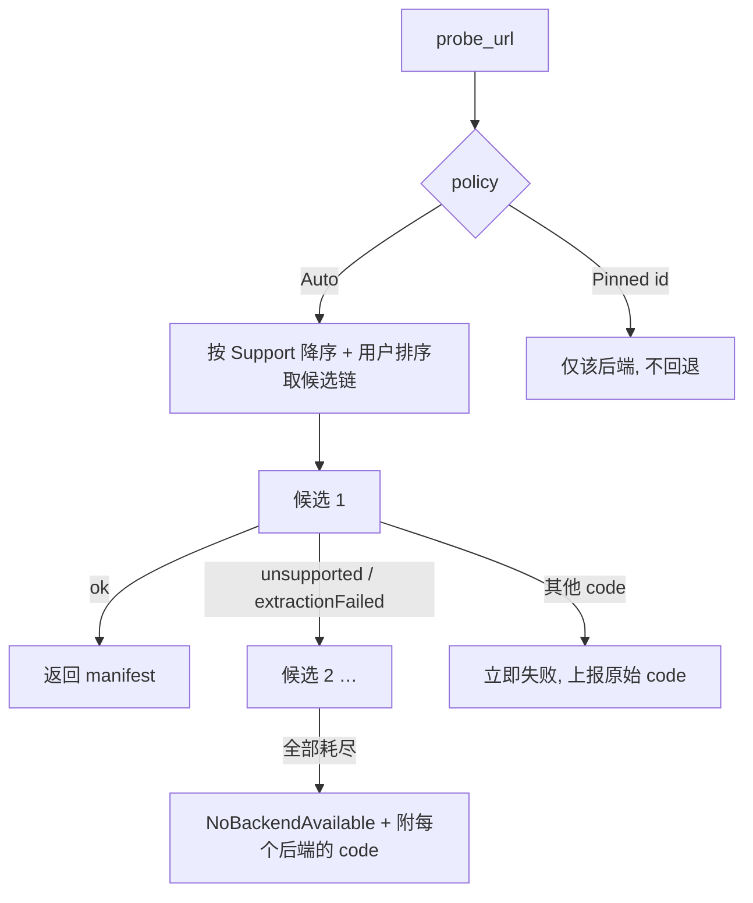

# AutoFox 后端契约

版本：v1（2026-09-25）
前置阅读：[02-概要设计](02-概要设计.md)

本文是 AutoFox 唯一需要提前定对的接口。它回答："用户能否在设置里选用哪个 exe？"以及"Python 版和 Rust 版能否走同一套契约？"

**答案：能，且两者是同一 trait 的不同实现。** 但要说清一件事——统一不是靠假设所有后端长得一样，而是靠**两层设计**：

| 层 | 面向 | 机制 |
|---|---|---|
| **L1 内部 trait** | AutoFox 自己的代码 | `Extractor` trait，下载层只见此层 |
| **L2 进程契约** | 外部可执行文件 | 原生协议 AFX-EP/1（新后端）+ 适配档（既有 CLI 如 yt-dlp） |

为什么需要适配档：**yt-dlp 的命令行参数格式是既定事实，AutoFox 无权更改**。把它的 `-J` 输出硬编码进 Rust 就等于把一个易变的外部契约焊死在编译产物里。改成声明式适配档后，yt-dlp 输出漂移只需改一个 TOML 文件，不需要重新编译。

---

## 1. L1：`Extractor` trait

```rust
//! src-tauri/src/extract/mod.rs

/// 后端实例标识。持久化进队列，恢复任务时知道当初由谁解析。
#[derive(Debug, Clone, PartialEq, Eq, Hash, Serialize, Deserialize)]
pub struct BackendId(pub String);   // "builtin-ytdlp" / "native-rustypipe" / 用户自定义

/// 路由判断，纯本地、不发网络请求。
#[derive(Debug, Clone, Copy, PartialEq, Eq, PartialOrd, Ord)]
pub enum Support {
    /// 明确不支持，跳过
    No,
    /// 大概能处理，值得一试（通配后端对任意 http(s)）
    Probable,
    /// 明确支持且为快路径（native 对 youtube.com）
    Native,
}

/// 能力声明。UI 据此**灰掉做不到的选项**，而不是让用户点了才失败。
#[derive(Debug, Clone, Copy, Serialize)]
#[serde(rename_all = "camelCase")]
pub struct Capabilities {
    pub playlist: bool,
    pub subtitles: bool,
    pub chapters: bool,
    pub cookies: bool,
    pub live: bool,
    pub po_token: bool,
    /// 能否边解析边推进度（AFX-EP/1 流式后端为 true，yt-dlp 一次性调用为 false）
    pub streaming_probe: bool,
}

#[derive(Debug, Clone, Serialize)]
#[serde(rename_all = "camelCase", tag = "status")]
pub enum BackendHealth {
    Ready { version: String, protocol: ProtocolKind },
    NotFound,
    VersionTooOld { found: String, required: String },
    ProtocolMismatch { detail: &'static str },
}

#[async_trait]
pub trait Extractor: Send + Sync {
    fn id(&self) -> &BackendId;
    fn display_name(&self) -> &str;
    fn capabilities(&self) -> Capabilities;

    /// 启动时探测一次，用户点"重新检测"时刷新。不在 probe 路径上调用。
    async fn health(&self) -> BackendHealth;

    fn supports(&self, url: &Url) -> Support;

    async fn probe(&self, req: &ProbeRequest, cancel: &CancelToken)
        -> Result<MediaManifest, ExtractError>;
}
```

实现者只有两个：

| 实现 | 覆盖 |
|---|---|
| `ProcessExtractor` | **所有外部可执行文件**——`yt-dlp.exe`、任何 AFX-EP/1 Rust CLI、开发期的 yt-dlp 源码树。差异全在适配档里 |
| `NativeExtractor` | 进程内 rustypipe，无子进程开销 |

### 1.1 关于 Python：运行期为零依赖

官方 `yt-dlp.exe` 是 PyInstaller 冻结产物（该项目的 `bundle/pyinstaller.py` 即其打包脚本），CPython 解释器与全部依赖都在 exe 内部。**AutoFox 用户不需要安装 Python。** `ffmpeg.exe` 同理，静态构建自带编解码器。

因此 `ProcessExtractor` 的生产形态只有两类，第三类仅存在于开发环境：

| 形态 | program | args 前缀 | 面向 |
|---|---|---|---|
| 冻结二进制 | `yt-dlp.exe` | `[]` | **生产，随包分发** |
| AFX-EP/1 二进制 | 任意路径 | 由用户配置 | 生产，用户自备 |
| 源码树（dev-only） | `uv` | `["run", "yt-dlp"]` + `cwd` 指向源码目录 | **仅开发调试**，不出现在发布产物 |

源码树形态用 `uv run` 而非裸 `python`：yt-dlp 自身携带 `uv.lock`（298 KB），uv 是它选定的开发工具，能保证依赖与 `requires-python >= 3.10` 一致，且无需在机器上全局装 Python。此形态仅供修改 yt-dlp 源码时验证，UI 中标记为「开发者选项」。

---

## 2. 归一化产物 `MediaManifest`

下载引擎只认这个类型，**永远不知道后端是谁**。

```rust
//! src-tauri/src/extract/manifest.rs

#[derive(Debug, Clone, Serialize, Deserialize)]
#[serde(rename_all = "camelCase")]
pub struct MediaManifest {
    pub source_id: String,
    pub title: String,
    pub uploader: Option<String>,
    pub duration_secs: Option<f64>,
    pub thumbnails: Vec<Thumbnail>,
    pub formats: Vec<Format>,
    pub subtitles: Vec<SubtitleTrack>,
    pub chapters: Vec<Chapter>,
    /// 谁解析的 + 版本。诊断与恢复一致性检查所需。
    pub produced_by: BackendId,
    pub backend_version: String,
    /// 后端独有信息的逃生口。UI 可展示，**下载层禁止读取**。
    #[serde(default)]
    pub extra: serde_json::Value,
}

#[derive(Debug, Clone, Serialize, Deserialize)]
#[serde(rename_all = "camelCase")]
pub struct Format {
    /// 后端自有命名空间，跨后端不可比。见 §6 的失效规则。
    pub format_id: String,
    pub delivery: Delivery,
    pub container: String,
    pub video: Option<VideoSpec>,
    pub audio: Option<AudioSpec>,
    pub size: SizeHint,
    /// 下载时必须原样带上，否则大概率 403。
    pub http_headers: Vec<(String, String)>,
}

#[derive(Debug, Clone, Serialize, Deserialize)]
#[serde(rename_all = "camelCase", tag = "kind")]
pub enum Delivery {
    Direct { url: String },
    Hls    { playlist_url: String },
    Dash   { manifest_url: String, representation_id: String },
}

#[derive(Debug, Clone, Copy, Serialize, Deserialize)]
#[serde(rename_all = "camelCase", tag = "kind", content = "bytes")]
pub enum SizeHint { Exact(u64), Approx(u64), Unknown }
```

`MediaManifest` 是所有后端的**交集**。native 后端的富元数据会被削平到 `extra`；这是可替换性的代价，明确接受。

---

## 3. L2：AFX-EP/1 进程协议（原生后端）

面向**我们能控制的后端**（未来的 Rust CLI、第三方实现）。实现了它的二进制**零适配代码**即可成为一等后端。

### 3.1 传输

- stdin 收命令，stdout 回响应，**均为 NDJSON**（一行一个 JSON 对象，UTF-8，`\n` 分隔）。
- stderr 仅供人读的日志，AutoFox 落本地日志文件，不解析。
- 进程**长驻**，多次请求复用，摊掉启动成本。
- 退出码：`0` 正常退出，非 `0` 视为 `BackendProtocol`。

### 3.2 握手

AutoFox 启动后端后先发：

```json
{"id":1,"method":"hello","params":{"protocol":"AFX-EP/1"}}
```

后端必须回：

```json
{"id":1,"ok":true,"result":{
  "protocol":"AFX-EP/1",
  "name":"autofox-extract-rs",
  "version":"0.3.0",
  "capabilities":{"playlist":true,"subtitles":true,"chapters":true,
                  "cookies":true,"live":false,"poToken":true,"streamingProbe":true},
  "urlPatterns":["^https?://(www\\.)?youtube\\.com/","^https?://youtu\\.be/"]
}}
```

`urlPatterns` 决定 `supports()` 返回 `Native`；缺省或为空视为通配 `Probable`。

### 3.3 解析

```json
{"id":2,"method":"probe","params":{
  "url":"https://example.com/watch?v=xxx",
  "playlist":false,
  "cookiesFrom":null,
  "proxy":null
}}
```

流式后端可在最终响应前推送任意条进度：

```json
{"id":2,"event":"progress","data":{"stage":"fetchingPlayer","pct":40}}
```

最终响应的 `result` 必须是 §2 的 `MediaManifest`（camelCase；`producedBy`/`backendVersion` 由 AutoFox 覆写，后端可省略）。

失败响应的 `code` **必须取自 §5 的枚举**——这是回退策略能正确工作的前提：

```json
{"id":2,"ok":false,"error":{"code":"unsupported","message":"no extractor for host"}}
```

### 3.4 取消

```json
{"id":3,"method":"cancel","params":{"cancelId":2}}
```

后端应尽快让 `id:2` 以 `code:"cancelled"` 收尾。超过 5s 未收尾，AutoFox 杀进程并重启后端。

---

## 4. L2：适配档（既有 CLI，如 yt-dlp）

`src-tauri/profiles/*.toml`。内置档随包分发，用户档放配置目录，同名覆盖内置。

```toml
# profiles/yt-dlp.toml
[profile]
id       = "ytdlp"
name     = "yt-dlp"
protocol = "adapted"          # 对应 AFX-EP/1 的 "native"
mode     = "oneshot"          # 每次请求起一个进程

[detect]
version_args   = ["--version"]
version_regex  = '^(\d{4}\.\d{2}\.\d{2})'
min_version    = "2024.01.01"

[capabilities]
playlist = true
subtitles = true
chapters = true
cookies = true
live = true
poToken = false
streamingProbe = false

[probe]
# {url} 是唯一插值位，由 AutoFox 以独立 argv 元素注入，不做 shell 拼接
args = ["-J", "--no-warnings", "--no-progress", "--", "{url}"]
output = "json-stdout"

[probe.flags]
playlist_off  = ["--no-playlist"]
playlist_on   = ["--yes-playlist"]
cookies_from  = ["--cookies-from-browser", "{browser}"]
proxy         = ["--proxy", "{proxy}"]

# 输出字段映射：左=MediaManifest 路径，右=后端 JSON 路径
[map]
source_id     = "id"
title         = "title"
uploader      = "uploader"
duration_secs = "duration"
thumbnails    = "thumbnails[]{url=url,width=width,height=height}"
formats       = "formats[]"

[map.format]
format_id     = "format_id"
url           = "url"
container     = "ext"
protocol      = "protocol"       # 据此判定 Delivery，见 [map.delivery]
filesize      = "filesize"
filesize_approx = "filesize_approx"
vcodec        = "vcodec"
acodec        = "acodec"
width         = "width"
height        = "height"
fps           = "fps"
tbr           = "tbr"
http_headers  = "http_headers"

[map.delivery]
# 后端 protocol 值 → Delivery 变体
direct = ["https", "http"]
hls    = ["m3u8", "m3u8_native"]
dash   = ["http_dash_segments"]

# 退出码/stderr → §5 错误码。首个匹配生效，无匹配则 extractionFailed
[[errors]]
match = "stderr~/Unsupported URL/i"
code  = "unsupported"

[[errors]]
match = "stderr~/Private video|members-only|Sign in/i"
code  = "authRequired"

[[errors]]
match = "stderr~/not available in your country|geo restricted/i"
code  = "geoRestricted"

[[errors]]
match = "stderr~/Unable to download|HTTP Error 5\\d\\d|timed out/i"
code  = "network"
```

三条硬约束：

1. **`{url}` 必须作为独立 argv 元素注入**，前面保留 `--`。绝不进 shell。
2. **映射缺字段一律降级，不报错**。后端每日提交，字段会增删。反序列化全部 `#[serde(default)]`，禁用 `deny_unknown_fields`。
3. **stdout 设大小上限**（默认 64 MiB，长播放列表可调）。超限 → `BackendProtocol`，防 OOM。

---

## 5. 错误码与回退

后端错误码（AFX-EP/1 的 `error.code` 与适配档的 `[[errors]].code` 共用同一集合）：

| code | 触发回退 | 语义 |
|---|---|---|
| `unsupported` | **是** | 该后端没有此站点的提取器 |
| `extractionFailed` | **是** | 站点改版/解析崩溃，换后端可能成功 |
| `authRequired` | 否 | 需凭据。换后端同样缺凭据 |
| `geoRestricted` | 否 | 地域限制，换后端无用 |
| `network` | 否 | 网络故障，换后端只会再超时一次 |
| `timedOut` | 否 | 同上 |
| `cancelled` | 否 | 用户意图，必须立即停 |
| `protocol` | 否 | 后端坏了，标记不健康并告警 |



**回退分界线是本设计最易做错之处。** 若对 `network` 也回退，用户断网时会串行捶遍所有后端、累加多次超时，并把真实原因掩盖成"全部失败"。

---

## 6. 跨后端一致性

`format_id` 是**后端自有命名空间**，跨后端无意义。因此：

- 队列任务持久化 `produced_by` + `backend_version` + 完整 `Format`（而非仅 id）。
- 恢复任务时：`produced_by` 仍在且版本未变 → 直接续传。后端被移除/换过/版本变了 → **重新 probe**，按 `container` + 分辨率 + 码率就近匹配；匹配不到则 `FormatUnavailable` 并要求用户重选。
- **绝不拿旧 `format_id` 去另一个后端要格式。**

媒体直链普遍带短期签名。已开始的任务用持久化的 URL 续传；403/410 时自动重新 probe 一次刷新直链，仍失败才报 `FormatUnavailable`。

---

## 7. 设置面

```text
解析后端
┌──────────────────────────────────────────────────────────────┐
│ ⠿ ☑ yt-dlp (随包自带)          2026.09.18   ● 就绪          │
│     适配档 yt-dlp · 通配所有站点                    [检测]   │
│ ⠿ ☑ rustypipe (内置原生)       0.11.4       ● 就绪          │
│     YouTube / YT Music 快路径                                │
│ ⠿ ☐ 我的 Rust 后端             0.3.0        ● 就绪          │
│     AFX-EP/1 · D:\tools\autofox-extract.exe     [检测][移除] │
└──────────────────────────────────────────────────────────────┘
             拖动 ⠿ 调整优先级 · Auto 策略按此顺序回退
                                                    [+ 添加后端]

策略  ● 自动（按上表顺序，仅 unsupported/extractionFailed 回退）
      ○ 固定使用：[yt-dlp ▾]（不回退，错误直接暴露）

添加后端对话框
  可执行文件  [D:\tools\...          ] [浏览…]
  启动参数    [                      ]  （仅自定义 CLI；yt-dlp 内置档自动填充）
  工作目录    [                      ]  （可选，仅开发源码调试用）
  接入方式    ● 自动探测   ○ AFX-EP/1 原生   ○ 适配档：[yt-dlp ▾]
                              [检测] → ✓ AFX-EP/1 · autofox-extract-rs 0.3.0

ffmpeg  [随包自带 · lib/ffmpeg.exe]  ● 就绪       [检测]
         ffprobe [随包自带 · lib/ffprobe.exe]
```

### 7.1 随包路径与探测顺序

默认布局：

```text
<安装目录>/
├─ AutoFox.exe
├─ yt-dlp.exe
└─ lib/
   ├─ ffmpeg.exe
   └─ ffprobe.exe
```

路径解析顺序固定为：

1. 随包路径：`<current_exe_dir>/yt-dlp.exe`、`<current_exe_dir>/lib/ffmpeg.exe`、`<current_exe_dir>/lib/ffprobe.exe`。
2. 用户设置中显式指定的路径。
3. PATH（默认关闭，仅用户主动开启时使用）。

默认**不静默回退到 PATH**，避免机器上旧版本覆盖随包版本。随包文件缺失时 UI 显示明确的修复动作，而不是把问题隐藏成后端解析失败。

`yt-dlp.exe` 为 PyInstaller 冻结产物，运行期不需要 Python。uv 只用于开发者从 yt-dlp 源码树运行 `uv run yt-dlp`，不参与正式应用启动。

"自动探测"的顺序：先发 AFX-EP/1 `hello`，1.5s 内拿到合规响应 → 原生后端；否则逐个试内置适配档的 `version_args`/`version_regex` → 匹配则用该档；都不匹配 → `ProtocolMismatch` 并说明。

**后端状态在启动时探测并推 `backend://health` 给 UI。探测不到就明确标灰 + 写清影响**，不要等用户点了下载才爆。默认安装应能直接发现同目录 `yt-dlp.exe` 和 `lib/ffmpeg.exe`，不要求 PATH。
---

## 8. 并发与资源

| 项 | 默认 | 理由 |
|---|---|---|
| 同时 probe 进程数 | 4 | 每个解析进程有独立内存；默认 yt-dlp.exe 无外部 Python 运行时 |
| 长驻后端实例数 | 每后端 1 | AFX-EP/1 支持并发 id 复用 |
| probe 超时 | 60s | 慢站点 + 播放列表需要余量 |
| 后端空闲回收 | 5min | 长驻进程不应无限占内存 |
| 进程组终止 | 必须 | 杀后端要连子进程一起（Windows Job Object），否则 yt-dlp 孵化的进程会漏 |

---

## 9. 测试要求

| 对象 | 方式 |
|---|---|
| 适配档映射 | 真实 `-J` 输出样本（离线 fixture）→ `MediaManifest` 断言 |
| 字段漂移容忍 | 删关键字段/加未知字段的 fixture 必须降级不崩 |
| 错误分类 | stderr 样本 → 期望 code；覆盖 §5 全表 |
| 回退边界 | 桩后端返回各 code，断言"仅 unsupported/extractionFailed 继续" |
| AFX-EP/1 | 用一个测试用桩二进制走完整 hello/probe/cancel 往返 |
| 注入防护 | URL 含 `--config-location`、`;`、` &&`、换行时不得改变 argv 结构 |

**不测**：透传、mock 回声、字段拷贝、源码文本。这些按 AutoAnt 约定用一次性脚本验证后删除。
